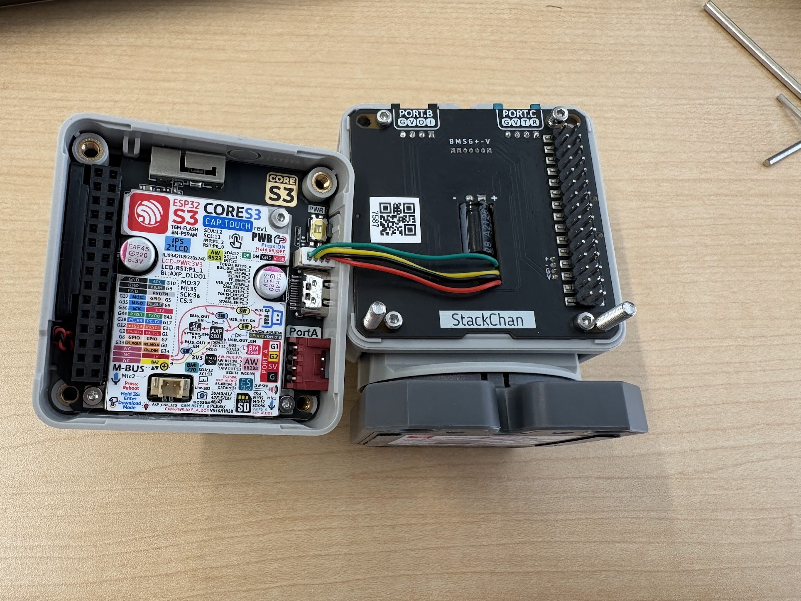
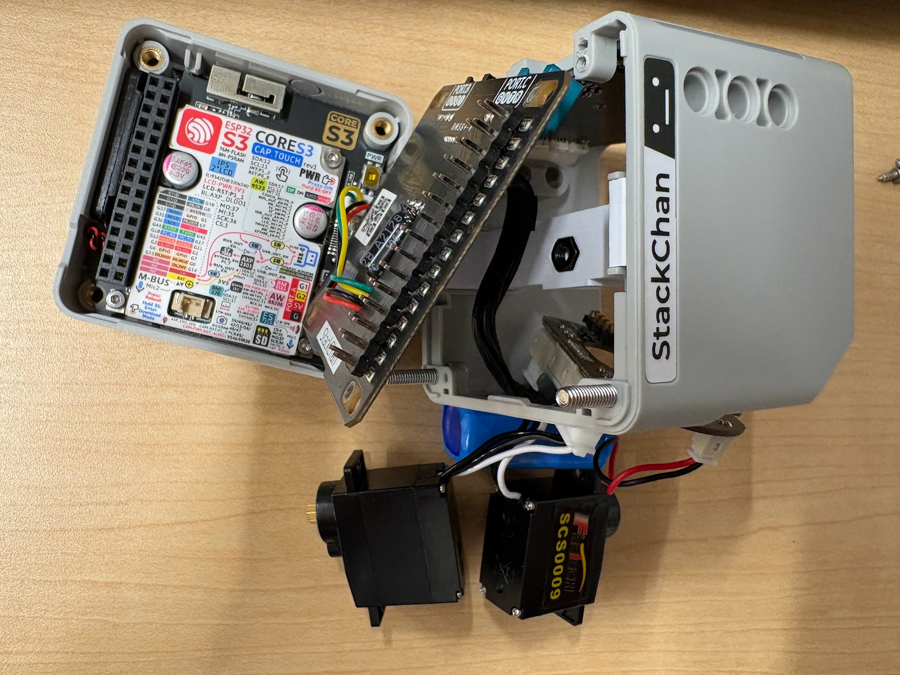
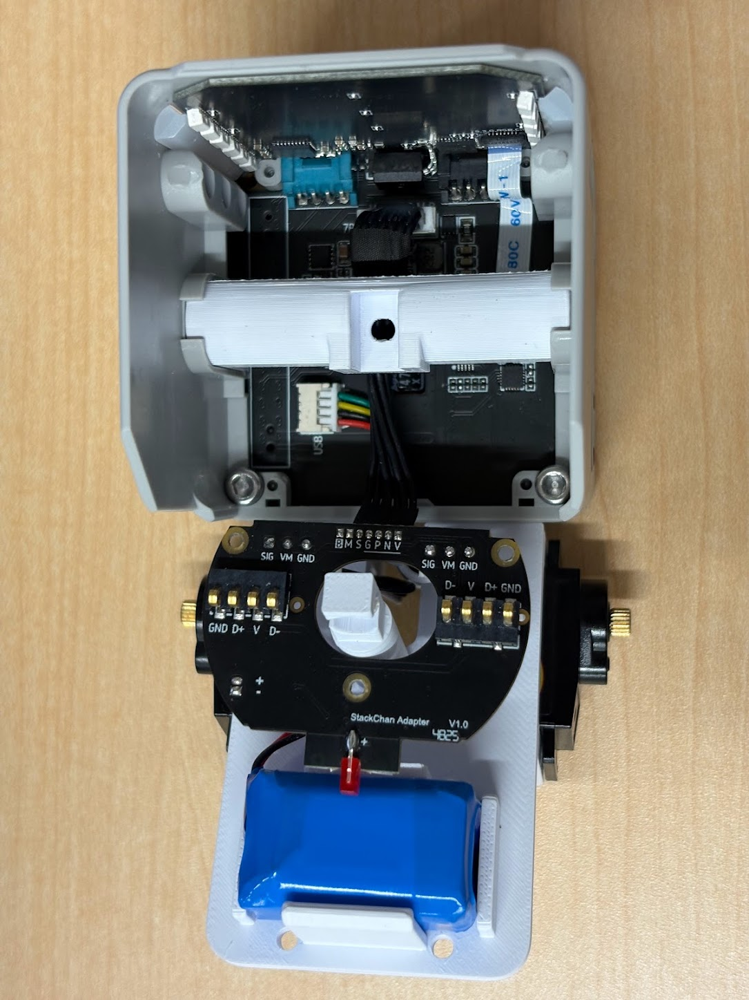
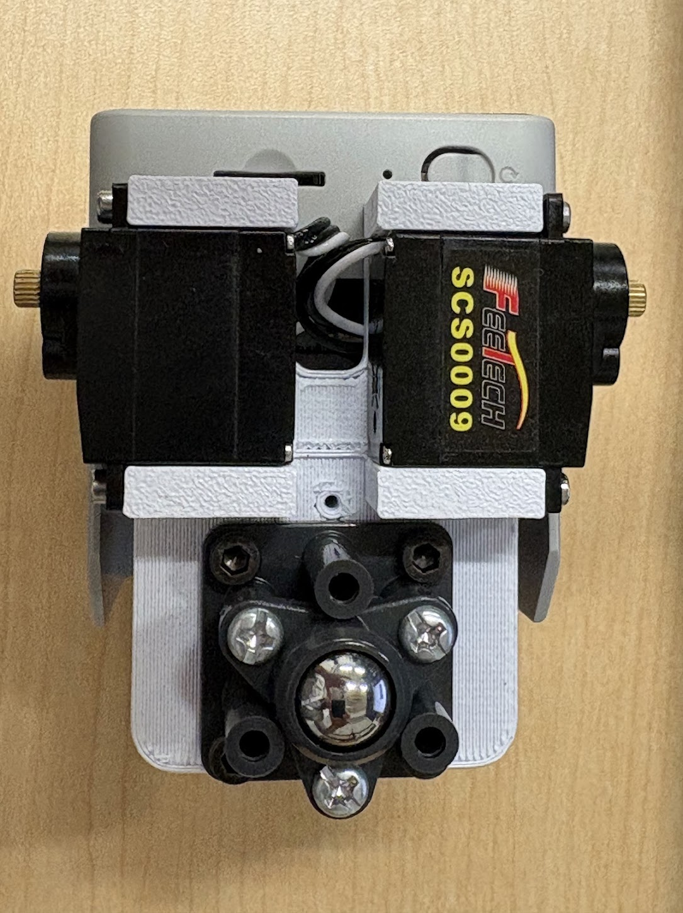
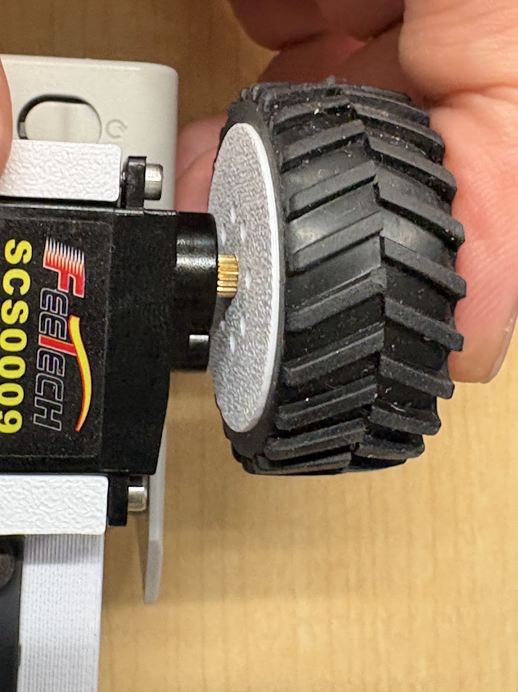
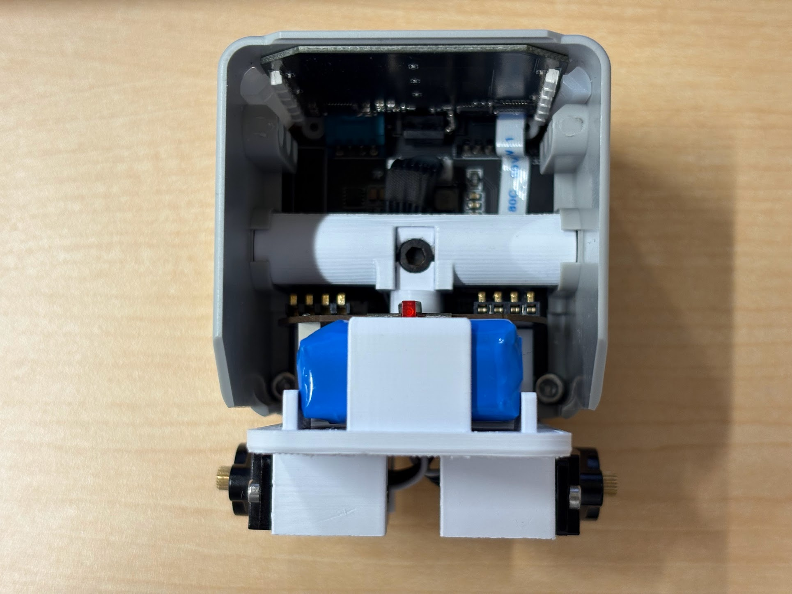

# 組立方法

## 準備するもの

- スタックチャン本体
- スタックチャン用リモートコントローラ（オプション）
- [タミヤ工作基本セット タイヤ](https://www.amazon.co.jp/dp/B001VZNA96)
- [タミヤ工作基本セット ボールキャスター](https://www.amazon.co.jp/dp/B001VZHRW2)
- 3DプリンタパーツA（[`PartA.stl`](PartA.stl)）
- 3DプリンタパーツB（[`PartB.stl`](PartB.stl)）
- 3DプリンタパーツC（[`PartC.stl`](PartC.stl)）☓2
- M2.4 長さ5mm六角ネジ ☓2
- M3 長さ3mm六角ネジ ☓4
- M3 長さ5mm六角ネジ ☓1
- M3 六角ナット ☓1

## 手順

### 1.

スタックチャンを分解します。顔の裏側下部のネジを外して顔部分のM5Coreを外し、その裏の基板を頭部から外して頭部と首振りメカニズム部分を分離します。

### 2.

首振りメカニズム部を分解して、中から下記を取り出してください。また、外したネジは保管してください。

- 首振り基板
- SCS0009サーボ ☓2
- バッテリー

### 3.

首振りメカニズム部分を抜いた部分に3DプリンタパーツAを装着し、顔裏の基板を戻してネジを止めます。M5Stackも戻してネジでとめます。

### 4.

3DプリンタパーツBに首振り基板、サーボ☓2、バッテリーを組み付けます。首振り基板とサーボの固定は首振りメカニズム部の分解で入手したネジを使用してください。バッテリーはそのまま後部に差し込むだけで大丈夫です。基板は8つの端子が上側になるように固定してください。

### 5.

3DプリンタパーツBにM3 長さ3mm六角ネジ ☓4を使ってボールキャスターを組み付けます（ボールキャスターの組み立ては説明書の通りに行ってください）。

### 6.

3DプリンタパーツCにタイヤを組み付けて、パーツCをサーボの出力軸に直線的に押し込みます（回さないように注意）。押し込みすぎてサーボ本体に接触しないように注意しながら、十分な深さに押し込んだらM2.4 長さ5mm六角ネジで固定します。

### 7.

3DプリンタパーツBと3DプリンタパーツAをM3 長さ5mm六角ネジとM3 六角ナットで固定します。六角ナットが脱落して組み立てしにくい場合は、両面テープやボンドで仮固定する、あるいはプリンタパーツの穴の部分の寸法を調整するなどで対処してください（組み立てづらくて申し訳ないです…。今後改良するかもしれません）。

### 8.

完成。充電、シリアル通信はM5Stack側のコネクタで行ってください。
